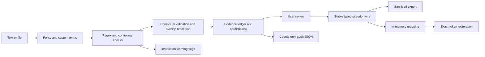

# ContextVault
**Share the context. Not the secrets.**

A local-first, browser-based data-loss prevention prototype for people who paste prompts, support tickets, logs or documents into generative AI services. It uses explainable pattern recognition and checksums, not an LLM or trained ML model. It is a manual pre-sharing workspace, not a browser-wide firewall.


## Quick start
Install Node.js 20+ and run:
```sh
npm test
npm run benchmark
npm start
```
Open http://127.0.0.1:8080. If port 8080 is busy, on PowerShell use `$env:PORT=4173; npm start`. On Bash use `PORT=4173 npm start`. No dependencies or credentials are required. Alternatively use the separate standalone HTML delivered with the submission bundle.

## Workflow
1. Load a fictional sample or paste/import plain text (100,000 characters max).
2. Select Standard, Strict or Developer policy; add literal custom terms if required.
3. Scan and review evidence. Uncheck any false positive; this deliberately retains the value.
4. Copy or export sanitized text; manually verify it before sending anywhere.
5. Paste the external tool's response containing the exact placeholders into Restore. Restore locally. The output is sensitive.
6. Export a counts-only JSON report or clear the session. The map is in memory only. Editing input, changing policy, clearing or reloading invalidates it. Do not expect restoration after a new scan.

## Technical architecture


## Implementation
- JavaScript ES modules, HTML5, CSS3, Node.js built-in HTTP server and test runner. No runtime dependencies, external assets, telemetry, API calls or storage APIs. Vercel headers and GitHub Actions included.
- Credential prefixes and assignment patterns; payment-card candidates with Luhn; Indian PAN and Aadhaar candidates with Verhoeff or strict contextual masking; email, phone, IPv4 and bank account labels; custom terms.
- Reviewable detection offsets/reasons, severity-prioritized overlap resolution, deterministic typed aliases and exact local restoration.
- Instruction warning patterns are advisory only, never a guarantee against prompt injection. They are not removed by masking.
- Exposure score is a capped weighted heuristic, not a probability of a breach. Masked counts are not recall or a measure of remaining real-world sensitive data.

## Actual evaluation
22/22 Node tests passed. On 30 hand-authored synthetic examples: TP=18, FP=2, FN=4, precision=90.0%, recall=81.8%, F1=85.7%. See `docs/benchmark.json` and `docs/test-results.txt`. The benchmark is not independent or representative of production; unsupported names, addresses, obfuscated emails and short passwords are deliberately included. Browser smoke test exercised the bundled standalone HTML in Chromium, including mobile width, exports, restoration, clear and no observed external requests. Hosted deployment has not been tested.

## Deployment
Create a public GitHub repository and push this folder. In Vercel, import the repo, choose framework **Other**, leave build command blank, set output directory to `.` (or use static GitHub Pages from `main` root). No env vars. Verify the public URL in an incognito browser. For GitHub Pages, select Settings → Pages → Deploy from a branch → main / (root); Vercel-specific HTTP headers will not apply on Pages; the meta CSP remains. Do not commit real examples or secrets. Upload demo video as unlisted YouTube or publicly viewable Drive and check access. No public URLs have been created in this package.

## Threat model and boundaries
See [security notes](docs/SECURITY.md). This prototype reduces exposure of recognized patterns, not all private information. It does not protect a compromised browser, extensions, clipboard, operating system, screen recordings, or malicious hosting changes. No identity validation, legal compliance claim, automated intercept or production DLP guarantee. Human review remains mandatory. Real data should not be used in the hackathon demo.

## Attribution and participation
AI-assisted initial implementation and documentation; verify the event's AI-use and originality rules, understand the code, review and make your own contributions before submitting. No third-party source code or runtime libraries are bundled. References: OWASP Top 10 for LLM Applications (Sensitive Information Disclosure), https://genai.owasp.org/llm-top-10/ ; Luhn and Verhoeff checksum algorithms. Names and identifiers in examples are fictional/test patterns; not verified identities.
